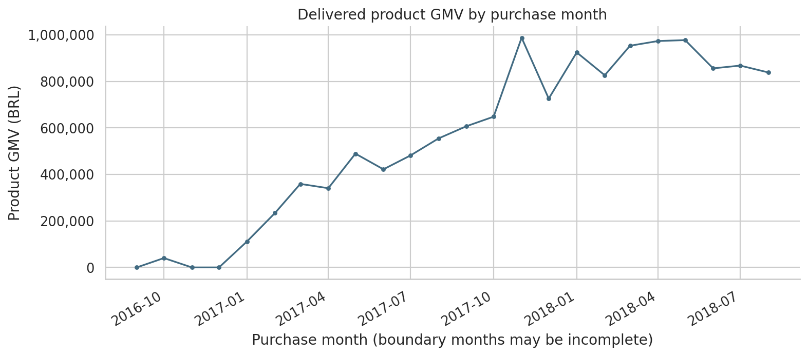
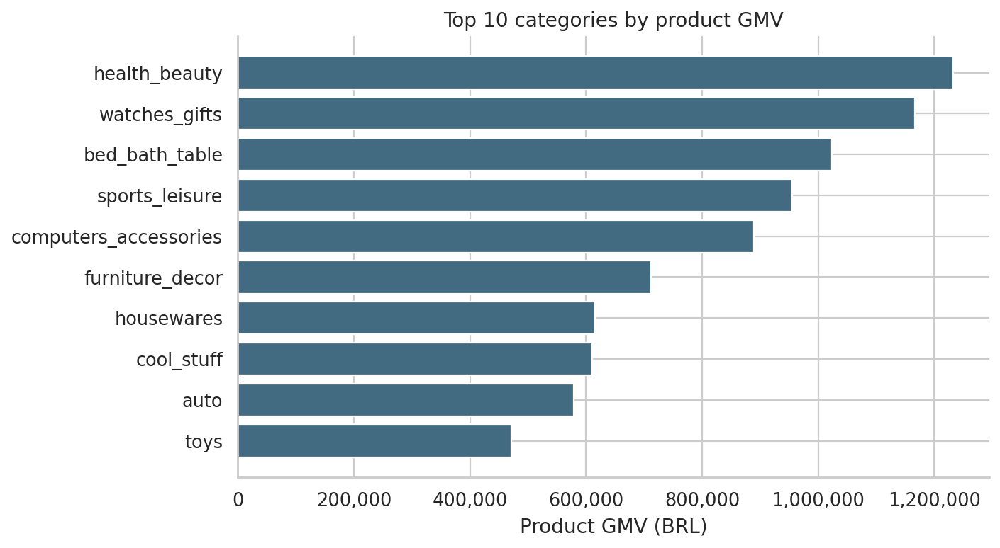
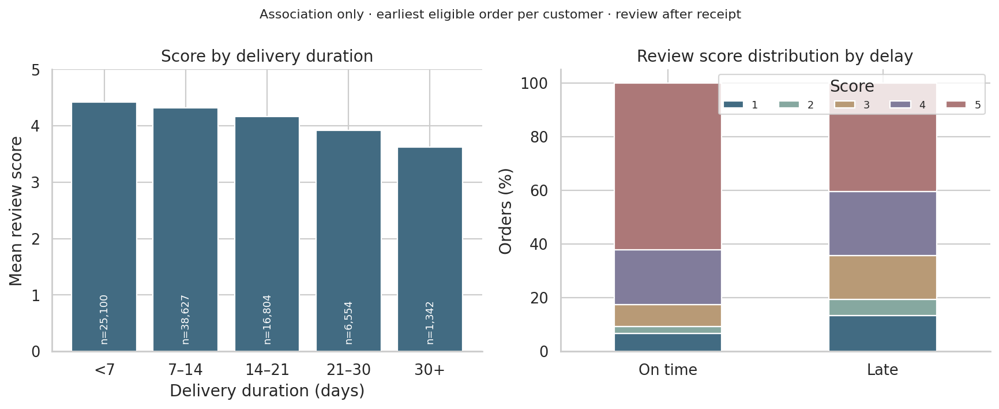
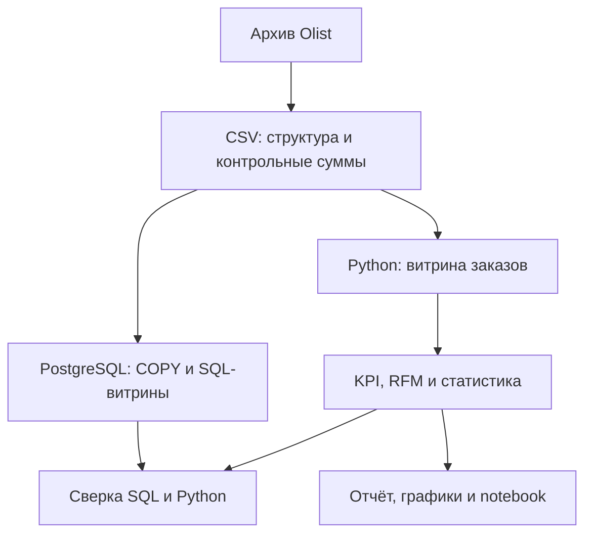

# E-Commerce Sales Analytics

В этом проекте я исследую продажи бразильского маркетплейса Olist: динамику товарного оборота, структуру категорий, повторные покупки и связь сроков доставки с оценками клиентов. Цель — получить воспроизводимые показатели и на их основе определить направления для дальнейшего анализа бизнеса.

Я подготовил витрину заказов в Python и PostgreSQL, рассчитал метрики двумя способами и добавил автоматическую сверку результатов. Особое внимание уделил объединению таблиц без двойного подсчёта, качеству исходных данных и ограничениям выводов.

**Стек:** Python · pandas · NumPy · PostgreSQL · SQLAlchemy · psycopg · SciPy · matplotlib · seaborn · Jupyter · pytest · Docker Compose.

[Результаты](#результаты) · [Устройство проекта](#устройство-проекта) · [Методика](#методика) · [Запуск](#запуск) · [Проверки](#проверки) · [Ограничения](#ограничения)

## Результаты

Аналитическая выборка — доставленные заказы с товарными позициями, совершённые с **15.09.2016 по 29.08.2018**. Валюта — бразильский реал (BRL).

| Показатель | Значение |
|---|---:|
| Доставленные заказы | 96 478 |
| Товарный GMV | 13 221 498,11 BRL |
| Средний чек | 137,04 BRL |
| Медиана стоимости заказа | 86,57 BRL |
| Среднее число позиций в заказе | 1,142 |
| Уникальные покупатели | 93 358 |
| Покупатели с двумя и более заказами | 2 801 — 3,00% |

**GMV — сумма стоимости товаров без доставки.** Этот показатель не равен прибыли, комиссии маркетплейса или сумме платежей.

### Продажи и ассортимент

Наибольший месячный GMV приходится на ноябрь 2017 года: **987 765,37 BRL и 7 289 заказов**. Без данных о рекламных кампаниях причину пика установить нельзя. Крайние месяцы наблюдения могут быть неполными.



Категория `health_beauty` формирует **9,33% GMV**, пять крупнейших категорий — **39,83%**. С них можно начать более подробное исследование ассортимента, учитывая, что большой оборот сам по себе не означает высокую маржинальность.



### Повторные покупки и доставка

Повторный доставленный заказ совершили **3,00% покупателей** в доступном окне наблюдения. Это описательная доля, а не оценка пожизненного удержания: для корректного сравнения когорт нужен одинаковый срок наблюдения.

Позже обещанного календарного дня получены **6,77% заказов с валидными датами доставки**. В статистической выборке отзывов после получения средняя оценка составляет **3,72 при задержке против 4,29 без задержки**. Проверка Mann–Whitney U выявляет различие распределений: p ≈ 4,53 × 10⁻⁹⁹, ранговая бисериальная корреляция −0,249. Наблюдаемая связь не доказывает причинного влияния задержки.



Практические направления: проверить обещанные сроки по продавцам и маршрутам, исследовать повторные покупки по когортам и оценить совместно покупаемые категории. Эффект изменений потребуется проверять отдельно.

Полные таблицы, статистическая интерпретация и рекомендации доступны в [аналитическом отчёте](reports/business_insights.md) и [notebook с сохранёнными результатами](notebooks/ecommerce_analysis.ipynb).

## Устройство проекта

| Путь | Назначение |
|---|---|
| `src/download_data.py` | Скачивание или импорт исходного архива, фиксация SHA-256 |
| `src/contracts.py`, `src/data_validation.py`, `src/provenance.py` | Структура данных, проверки ключей и значений, контроль происхождения |
| `src/preprocessing.py` | Чтение CSV и подготовка витрины с одной строкой на заказ |
| `src/metrics.py`, `src/statistics.py` | Метрики продаж, RFM, статистический тест и bootstrap |
| `src/visualization.py`, `src/reporting.py` | Семь графиков и формирование аналитического отчёта |
| `src/run_analysis.py` | Полный Python-анализ |
| `src/load_data.py` | Транзакционная загрузка в PostgreSQL через COPY |
| `src/verify_sql.py` | Выполнение SQL и сверка с Python |
| `src/execute_notebook.py` | Выполнение notebook |
| `sql/01_schema.sql` | Таблицы, ограничения, индексы и представления |
| `sql/02_data_quality.sql` | Проверки качества данных |
| `sql/03_sales_analysis.sql` | KPI, динамика по месяцам, LAG, категории |
| `sql/04_customer_analysis.sql` | Клиенты, повторные покупки, ROW_NUMBER |
| `sql/05_advanced_queries.sql` | Накопленный вклад категорий, доставка, сверка платежей |
| `notebooks/` | Анализ с кодом, пояснениями и сохранёнными результатами |
| `reports/` | Аналитический отчёт, агрегаты CSV/JSON и графики |
| `data/raw/`, `data/processed/` | Локальные исходные данные и витрины; исключены из Git |
| `tests/` | Модульные и интеграционные тесты |
| `.github/workflows/tests.yml` | Проверки в GitHub Actions с PostgreSQL и Python 3.11/3.12 |



## Методика

### Выборка и объединение таблиц

Покупателя я определяю по `customer_unique_id`: `customer_id` относится к записи клиента для конкретного заказа и не подходит для подсчёта повторных покупок.

Позиции и платежи агрегируются **отдельно по `order_id` до JOIN**. Иначе заказ с двумя позициями и двумя платежами даст четыре строки и завышенные суммы. Для отзывов выбирается последний ответ с детерминированным разрешением совпадений. Витрина `order_facts` сохраняет ровно одну строку на каждый исходный заказ.

Продажи рассчитываются для статуса `delivered` при наличии хотя бы одной позиции. Месяц определяется датой покупки, статус — финальным снимком данных. Заказы без даты получения могут входить в продажи, но исключаются из расчёта сроков доставки. Категорийный GMV можно суммировать, число заказов по категориям — нельзя: один заказ может содержать несколько категорий.

### Качество данных

- Проверяются обязательные поля, первичные и внешние ключи, денежные значения и контрольные суммы CSV.
- В Python деньги хранятся в целых сентаво, в PostgreSQL — `NUMERIC(14,2)` в BRL. Итоговые показатели и графики представлены в BRL; денежные поля исходного профиля `data_profile.json` — в сентаво.
- Пропущенные даты и оценки не восстанавливаются искусственно. Для категории используется перевод, исходное название или `unknown`.
- `review_id` отдельно не уникален: ключ отзывов составной — `(order_id, review_id)`.
- Платежи сверяются со стоимостью товаров и доставки. Расхождения более 0,01 BRL фиксируются для диагностики.
- Дорогие корректные заказы остаются в расчётах. Ограничение до P99 применяется только к двум гистограммам и указано в их заголовках.
- Пустые внутренние месяцы получают нулевые GMV и число заказов; средний чек и MoM при нулевом знаменателе не определяются.

Подробности проверок: [data_quality.csv](reports/data_quality.csv), [data_profile.json](reports/data_profile.json). Происхождение данных и контрольные суммы: [source_manifest.json](reports/source_manifest.json).

### RFM-сегментация

Дата расчёта — **18.10.2018**, день после последней покупки во всей исходной таблице заказов. R — дни с последней доставленной покупки, F — число доставленных заказов, M — их товарный GMV.

Из-за большого числа разовых покупателей частота разделена на уровни **1 / 2 / 3+**. R и M получают три уровня по процентильным рангам с усреднением совпадений: `R-score = ceil(3 × rank_pct(R, descending))`, `M-score = ceil(3 × rank_pct(M, ascending))`. Больший балл означает более благоприятное значение. Правила применяются сверху вниз:

| Сегмент | Правило |
|---|---|
| Active repeat | F ≥ 2, R-score ≥ 2, M-score ≥ 2 |
| Lapsed repeat | F ≥ 2, R-score = 1 |
| Other repeat | Остальные F ≥ 2 |
| Recent high value | F = 1, R-score = 3, M-score = 3 |
| Older one-time | Остальные R-score = 1 |
| Other one-time | Остальные покупатели |

Сегменты описывают наблюдаемые покупки и не являются прогнозом поведения.

### Статистическая проверка

Гипотеза H₀: распределения оценок одинаковы у заказов с задержкой и без неё. Проверка двусторонняя, α = 0,05. Используется первый подходящий заказ каждого покупателя с отзывом после получения: **1 855 заказов с задержкой и 86 572 без задержки**.

Mann–Whitney U выбран для порядковых оценок 1–5 с поправкой на связанные ранги. Он не является чистым тестом разности медиан. Разность средних −0,57 приведена отдельно для масштаба; bootstrap 95% ДИ — **[−0,63; −0,51]**, 1 000 повторов, seed 42.

Исключение отзывов до получения особенно сильно меняет группу задержанных заказов. Если включить такие отзывы, средняя оценка в этой группе составляет 2,266 вместо 3,72; соответствующее описательное сравнение сохранено в отчёте. Основной результат нельзя переносить на все заказы. Общие продавцы, регионы и сезонность также могут создавать зависимость наблюдений.

## Запуск

Нужны Python 3.11 или 3.12 и, для SQL-части, Docker Desktop с Docker Compose. Для Python-анализа база данных не требуется. Все команды выполняются **из корня репозитория**, где находятся `requirements.txt` и `docker-compose.yml`.


Результаты появятся в `reports/`, подготовленные витрины — в `data/processed/`. Если автоматическое скачивание недоступно, архив можно скачать со [страницы Olist](https://www.kaggle.com/datasets/olistbr/brazilian-ecommerce) и импортировать:

```powershell
& $py -m src.download_data --archive "C:\path\to\archive.zip"
```

